# LAPORAN PRAKTIKUM 4
## CSS LAYOUT

**Nama:** M. Fahmi Abdul B.  
**NIM:** 312510260  
**Program Studi:** Teknik Informatika  
**Universitas:** Universitas Pelita Bangsa

---

## 1. Tujuan Praktikum

1. Mahasiswa mampu memahami struktur dasar pembuatan Layout.
2. Mahasiswa mampu memahami konsep Box Element.
3. Mahasiswa mampu memahami CSS Floating.
4. Mahasiswa mampu memahami HTML5 Semantic Element.
5. Mahasiswa mampu membuat Layout Web Sederhana.

## 2. Langkah-Langkah Praktikum

### 2.1 Persiapan Dokumen HTML

Membuat folder praktikum dengan nama `Lab4Web`, kemudian membuat file `lab4_box.html` menggunakan Visual Studio Code.

Kode HTML awal:

```html
<!DOCTYPE html>
<html lang="en">
<head>
    <meta charset="UTF-8">
    <meta name="viewport" content="width=device-width, initial-scale=1.0">
    <title>Box Element</title>
</head>
<body>
    <header>
        <h1>Box Element</h1>
    </header>
</body>
</html>
```

**Screenshot:** Tampilan awal dokumen HTML di VS Code dan browser.

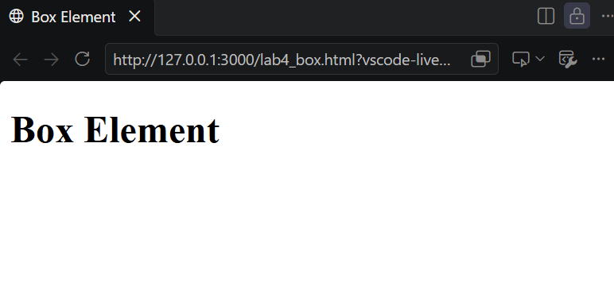

### 2.2 Membuat Box Element

Menambahkan elemen `<div>` di dalam elemen `<section>` untuk membuat tiga kotak.

Kode HTML:

```html
<section>
    <div class="div1">Div 1</div>
    <div class="div2">Div 2</div>
    <div class="div3">Div 3</div>
</section>
```

Kode CSS:

```css
div {
    padding: 10px;
}

.div1 {
    background: red;
}

.div2 {
    background: yellow;
}

.div3 {
    background: green;
}
```

**Penjelasan:** Elemen div digunakan sebagai kotak yang dapat diberikan warna dan padding menggunakan CSS.


### 2.3 Menggunakan CSS Float Property

Menambahkan properti `float: left` pada CSS agar ketiga elemen div berada berdampingan.

Kode CSS:

```css
div {
    float: left;
    padding: 10px;
}

.div1 {
    background: red;
}

.div2 {
    background: yellow;
}

.div3 {
    background: green;
}
```

**Penjelasan:** Properti float digunakan untuk mengatur posisi elemen agar mengambang ke sisi kiri atau kanan.

**Screenshot:** Hasil CSS Float Property.

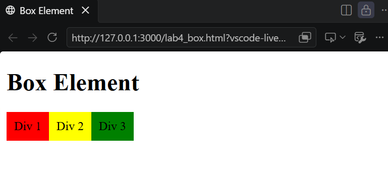

### 2.4 Mengatur Clearfix Element

Menambahkan elemen Div 4 setelah Div 3.

Kode HTML:

```html
<section>
    <div class="div1">Div 1</div>
    <div class="div2">Div 2</div>
    <div class="div3">Div 3</div>
    <div class="div4">Div 4</div>
</section>
```

Kode CSS:

```css
.div4 {
    background-color: blue;
    clear: left;
    float: none;
}
```

**Penjelasan:** Properti `clear` digunakan untuk mengatur posisi elemen terhadap elemen yang menggunakan float.

Selanjutnya dilakukan eksperimen dengan nilai `left`, `both`, dan `right` untuk mengamati perbedaan posisi elemen.

**Screenshot:** Hasil Clearfix Element.

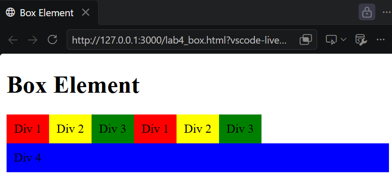

### 2.5 Membuat Layout Sederhana

Membuat folder baru dengan nama `lab4_layout`, kemudian membuat dua file, yaitu `home.html` dan `style.css`.

Struktur folder:

```text
Lab4Web/
├── lab4_box.html
└── lab4_layout/
    ├── home.html
    ├── style.css
    ├── artikel.html
    ├── about.html
    └── kontak.html
```

Kode awal `home.html`:

```html
<!DOCTYPE html>
<html lang="en">
<head>
    <meta charset="UTF-8">
    <meta name="viewport" content="width=device-width, initial-scale=1.0">
    <title>Layout Sederhana</title>
    <link rel="stylesheet" href="style.css">
</head>
<body>
    <div id="container">

    </div>
</body>
</html>
```

**Screenshot:** Struktur folder dan dokumen layout di VS Code.

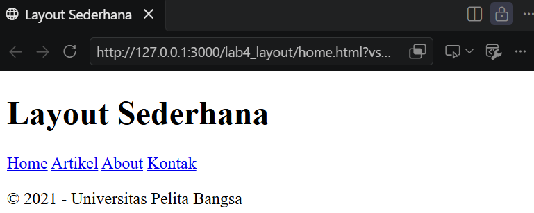

### 2.6 Membuat Kerangka Layout dengan Semantic Element

Menambahkan elemen semantik HTML5 ke dalam container.

Kode HTML:

```html
<header>
    <h1>Layout Sederhana</h1>
</header>

<nav>
    <a href="home.html" class="active">Home</a>
    <a href="artikel.html">Artikel</a>
    <a href="about.html">About</a>
    <a href="kontak.html">Kontak</a>
</nav>

<section id="hero"></section>

<section id="wrapper">
    <section id="main"></section>
    <aside id="sidebar"></aside>
</section>

<footer>
    <p>&copy; 2021 - Universitas Pelita Bangsa</p>
</footer>
```

**Penjelasan:** Kerangka layout terdiri dari header, navigasi, hero panel, main content, sidebar, dan footer.

**Screenshot:** Tampilan kerangka layout.

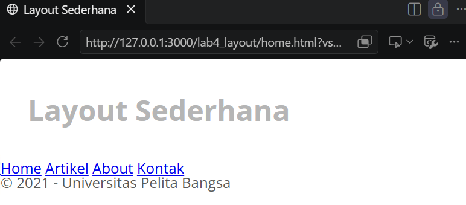

### 2.7 Mengatur CSS Dasar dan Header

Menambahkan CSS untuk mengatur font, margin, padding, warna teks, lebar container, dan header.

Kode CSS:

```css
/* import google font */
@import url('https://fonts.googleapis.com/css2?family=Open+Sans:wght@300;400;600;700;800&display=swap');

/* Reset CSS */
* {
    margin: 0;
    padding: 0;
}

body {
    line-height: 1;
    font-size: 100%;
    font-family: 'Open Sans', sans-serif;
    color: #5a5a5a;
}

#container {
    width: 980px;
    margin: 0 auto;
    box-shadow: 0 0 1em #cccccc;
}

/* header */
header {
    padding: 20px;
}

header h1 {
    margin: 20px 10px;
    color: #b5b5b5;
}
```

**Penjelasan:** CSS dasar digunakan untuk mengatur tampilan keseluruhan halaman, sedangkan header berfungsi sebagai bagian judul website.


### 2.8 Membuat Navigasi

Menambahkan CSS untuk mengatur tampilan menu navigasi.

Kode CSS:

```css
/* navigasi */
nav {
    display: block;
    background-color: #1f5faa;
}

nav a {
    padding: 15px 30px;
    display: inline-block;
    color: #ffffff;
    font-size: 14px;
    text-decoration: none;
    font-weight: bold;
}

nav a.active,
nav a:hover {
    background-color: #2b83ea;
}
```

**Penjelasan:** Navigasi digunakan untuk berpindah ant halaman. Warna latar dan efek hover diatur menggunakan CSS.

**Screenshot:** Hasil navigasi website.

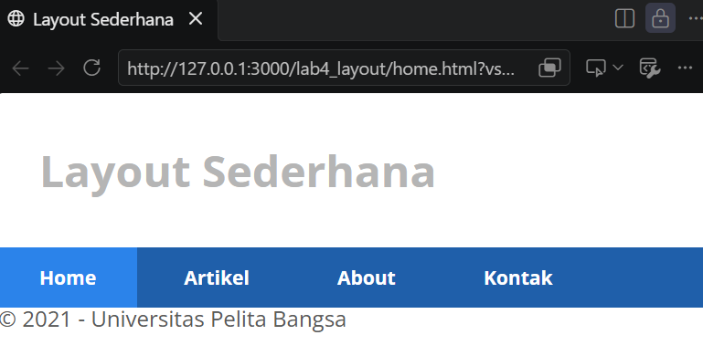

### 2.9 Membuat Hero Panel

Menambahkan judul, paragraf, dan tombol pada bagian hero panel.

Kode HTML:

```html
<section id="hero">
    <h1>Hello World!</h1>
    <p>
        Lorem ipsum dolor sit amet, consectetur adipiscing elit.
        Vestibulum lorem elit, iaculis in nisl volutpat,
        malesuada tincidunt arcu. Proin in leo fringilla,
        vestibulum mi porta, faucibus felis.
    </p>
    <a href="home.html" class="btn btn-large">
        Learn more &raquo;
    </a>
</section>
```

Kode CSS:

```css
/* Hero Panel */
#hero {
    background-color: #e4e4e5;
    padding: 50px 20px;
    margin-bottom: 20px;
}

#hero h1 {
    margin-bottom: 20px;
    font-size: 35px;
}

#hero p {
    margin-bottom: 20px;
    font-size: 18px;
    line-height: 25px;
}
```

**Penjelasan:** Hero panel merupakan bagian yang digunakan untuk menampilkan judul utama dan informasi pengantar website.

**Screenshot:** Hasil Hero Panel.

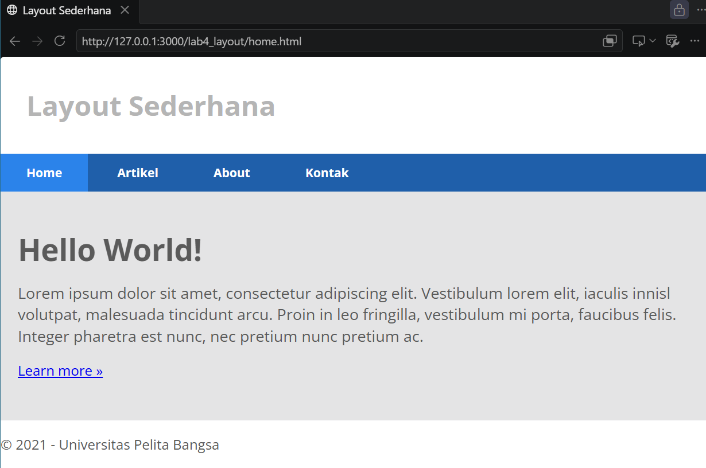

### 2.10 Mengatur Main Content dan Sidebar

Menambahkan CSS float untuk mengatur posisi konten utama dan sidebar.

Kode CSS:

```css
/* main content */
#wrapper {
    margin: 0;
}

#main {
    float: left;
    width: 640px;
    padding: 20px;
}

/* sidebar area */
#sidebar {
    float: left;
    width: 260px;
    padding: 20px;
}
```

**Penjelasan:** Main content digunakan untuk menampilkan isi utama halaman, sedangkan sidebar digunakan untuk informasi tambahan.

**Screenshot:** Hasil pengaturan main content dan sidebar.


### 2.11 Membuat Sidebar Widget

Menambahkan dua widget pada sidebar, yaitu Widget Header dan Widget Text.

Kode HTML:

```html
<aside id="sidebar">
    <div class="widget-box">
        <h3 class="title">Widget Header</h3>
        <ul>
            <li><a href="#">Widget Link</a></li>
            <li><a href="#">Widget Link</a></li>
            <li><a href="#">Widget Link</a></li>
            <li><a href="#">Widget Link</a></li>
            <li><a href="#">Widget Link</a></li>
        </ul>
    </div>

    <div class="widget-box">
        <h3 class="title">Widget Text</h3>
        <p>
            Vestibulum lorem elit, iaculis in nisl volutpat,
            malesuada tincidunt arcu. Proin in leo fringilla,
            vestibulum mi porta, faucibus felis.
        </p>
    </div>
</aside>
```

Kode CSS:

```css
/* widget */
.widget-box {
    border: 1px solid #eee;
    margin-bottom: 20px;
}

.widget-box .title {
    padding: 10px 16px;
    background-color: #428bca;
    color: #fff;
}

.widget-box ul {
    list-style-type: none;
}

.widget-box li {
    border-bottom: 1px solid #eee;
}

.widget-box li a {
    padding: 10px 16px;
    color: #333;
    display: block;
    text-decoration: none;
}

.widget-box li:hover a {
    background-color: #eee;
}

.widget-box p {
    padding: 15px;
    line-height: 25px;
}
```

**Penjelasan:** Widget digunakan untuk menampilkan daftar tautan dan informasi tambahan di bagian sidebar.

**Screenshot:** Hasil Sidebar Widget.

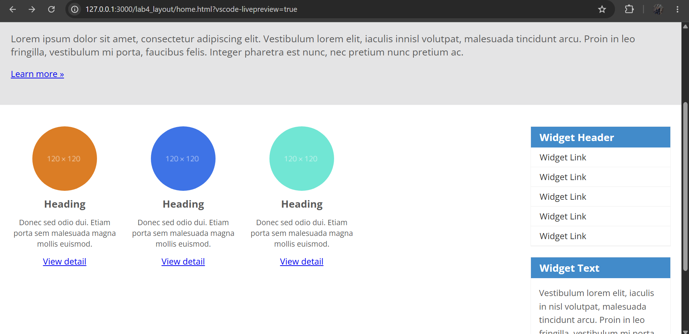

### 2.12 Mengatur Footer

Menambahkan CSS untuk mengatur tampilan footer.

Kode CSS:

```css
/* footer */
footer {
    clear: both;
    background-color: #1d1d1d;
    padding: 20px;
    color: #eee;
}
```

**Penjelasan:** Footer merupakan bagian bawah halaman website. Properti `clear: both` membuat footer berada di bawah elemen yang menggunakan float ke kiri maupun kanan.


### 2.13 Menambahkan Elemen Lain pada Main Content

Menambahkan tiga kotak konten yang masing-masing berisi gambar, heading, paragraf, dan tombol.

Kode HTML:

```html
<section id="main">
    <div class="row">
        <div class="box">
            
            <h3>Heading</h3>
            <p>Donec sed odio dui. Etiam porta sem malesuada magna mollis euismod.</p>
            <a href="#" class="btn btn-default">View detail</a>
        </div>

        <div class="box">
            
            <h3>Heading</h3>
            <p>Donec sed odio dui. Etiam porta sem malesuada magna mollis euismod.</p>
            <a href="#" class="btn btn-default">View detail</a>
        </div>

        <div class="box">
            
            <h3>Heading</h3>
            <p>Donec sed odio dui. Etiam porta sem malesuada magna mollis euismod.</p>
            <a href="#" class="btn btn-default">View detail</a>
        </div>
    </div>
</section>
```

Kode CSS:

```css
/* box */
.box {
    display: block;
    float: left;
    width: 33.333333%;
    box-sizing: border-box;
    padding: 0 10px;
    text-align: center;
}

.box h3 {
    margin: 15px 0;
}

.box p {
    line-height: 20px;
    font-size: 14px;
    margin-bottom: 15px;
}

.box img {
    border: 0;
    vertical-align: middle;
}

.image-circle {
    border-radius: 50%;
}

.row {
    margin: 0 -10px;
    box-sizing: border-box;
}

.row:after,
.row:before,
.entry:after,
.entry:before {
    content: '';
    display: table;
}

.row:after,
.entry:after {
    clear: both;
}
```

**Penjelasan:** Bagian ini digunakan untuk menampilkan beberapa kotak konten secara berdampingan dengan gambar berbentuk lingkaran.


### 2.14 Menambahkan Content Artikel

Menambahkan dua artikel menggunakan elemen `<article>`.

Kode HTML:

```html
<hr class="divider">

<article class="entry">
    <h2>First featurette heading.</h2>
    
    <p>
        Lorem ipsum dolor sit amet, consectetur adipiscing elit.
        Vestibulum lorem elit, iaculis in nisl volutpat,
        malesuada tincidunt arcu. Proin in leo fringilla,
        vestibulum mi porta, faucibus felis.
    </p>
</article>

<hr class="divider">

<article class="entry">
    <h2>First featurette heading.</h2>
    
    <p>
        Lorem ipsum dolor sit amet, consectetur adipiscing elit.
        Vestibulum lorem elit, iaculis in nisl volutpat,
        malesuada tincidunt arcu. Proin in leo fringilla,
        vestibulum mi porta, faucibus felis.
    </p>
</article>
```

Kode CSS:

```css
.divider {
    border: 0;
    border-top: 1px solid #eeeeee;
    margin: 40px 0;
}

/* entry */
.entry {
    margin: 15px 0;
}

.entry h2 {
    margin-bottom: 20px;
}

.entry p {
    line-height: 25px;
}

.entry img {
    float: left;
    border-radius: 5px;
    margin-right: 15px;
}

.entry .right-img {
    float: right;
}
```

**Penjelasan:** Artikel berisi judul, gambar, dan paragraf. Properti float digunakan untuk menempatkan gambar di sebelah kiri atau kanan teks.

**Screenshot:** Hasil Content Artikel.

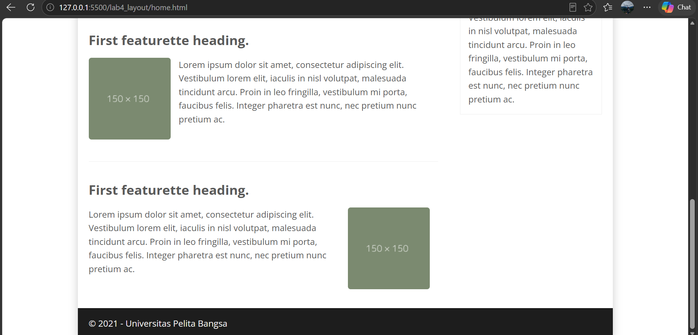

## 2.15 Tugas Praktikum: Membuat Halaman About

Pada tahap ini, dibuat halaman **About** yang berisi deskripsi diri, keahlian, dan portfolio menggunakan HTML dan CSS.

### A. File `about.html`

File ini digunakan untuk membuat struktur halaman About, yang terdiri dari header, navigasi, deskripsi diri, daftar keahlian, portfolio, dan footer.

```html
<!DOCTYPE html>
<html lang="id">
<head>
    <meta charset="UTF-8">
    <meta name="viewport" content="width=device-width, initial-scale=1.0">
    <title>About - Layout Sederhana</title>
    <link rel="stylesheet" href="about.css">
</head>
<body>
    <div id="container">

        <header id="header">
            <h1>Layout Sederhana</h1>
        </header>

        <nav id="menu">
            <ul>
                <li><a href="home.html">Home</a></li>
                <li><a href="artikel.html">Artikel</a></li>
                <li><a href="about.html" class="active">About</a></li>
                <li><a href="contact.html">Kontak</a></li>
            </ul>
        </nav>

        <main class="about-content">
            <h2>About Me</h2>

            <p>
                Selamat datang di halaman About.
                Halaman ini berisi informasi singkat tentang diri saya,
                deskripsi, keahlian, dan portfolio.
            </p>

            <h3>Deskripsi Diri</h3>

            <p>
                Saya adalah seorang mahasiswa yang sedang mempelajari
                pengembangan website menggunakan HTML dan CSS.
                Saya tertarik mempelajari teknologi informasi,
                desain web, dan pemrograman.
            </p>

            <h3>Keahlian</h3>

            <ul>
                <li>HTML untuk membuat struktur halaman web.</li>
                <li>CSS untuk mengatur tampilan website.</li>
                <li>Desain layout website sederhana.</li>
            </ul>

            <h3>Portfolio</h3>

            <div class="portfolio">
                <div class="portfolio-item">
                    <h4>Project 1</h4>
                    <p>Membuat halaman website menggunakan HTML.</p>
                </div>

                <div class="portfolio-item">
                    <h4>Project 2</h4>
                    <p>Mengatur layout website menggunakan CSS.</p>
                </div>

                <div class="portfolio-item">
                    <h4>Project 3</h4>
                    <p>Membuat navigasi dan halaman website.</p>
                </div>
            </div>
        </main>

        <footer id="footer">
            <p>&copy; 2026 - Layout Sederhana</p>
        </footer>

    </div>
</body>
</html>
```

### B. File `about.css`

File ini digunakan untuk mengatur tampilan halaman About, termasuk jarak konten, warna teks, bagian portfolio, dan tampilan responsif.

```css
/* Layout halaman About */
.about-content {
    padding: 30px;
    background: #ffffff;
    color: #444;
    line-height: 1.8;
    min-height: 400px;
}

.about-content h2 {
    font-size: 30px;
    color: #333;
    margin-top: 0;
}

.about-content h3 {
    color: #2765a5;
    margin-top: 25px;
}

.portfolio {
    display: flex;
    flex-wrap: wrap;
    gap: 20px;
    margin-top: 20px;
}

.portfolio-item {
    flex: 1 1 200px;
    padding: 20px;
    background: #f2f2f2;
    border-left: 4px solid #2765a5;
    border-radius: 5px;
    box-sizing: border-box;
}

.portfolio-item h4 {
    color: #2765a5;
    margin-top: 0;
}

@media (max-width: 600px) {
    .about-content {
        padding: 20px;
    }

    .portfolio {
        flex-direction: column;
    }
}

/* Layout utama */
* {
    box-sizing: border-box;
}

body {
    margin: 0;
    background: #eeeeee;
    font-family: Arial, sans-serif;
    color: #444;
}

#container {
    width: 90%;
    max-width: 1260px;
    margin: 0 auto;
    background: #ffffff;
    box-shadow: 0 0 10px rgba(0, 0, 0, 0.1);
}

#header {
    padding: 30px 40px;
    background: #ffffff;
}

#header h1 {
    margin: 0;
    color: #aaaaaa;
    font-size: 40px;
}

#menu {
    background: #2765a5;
}

#menu ul {
    display: flex;
    list-style: none;
    padding: 0;
    margin: 0;
}

#menu ul li a {
    display: block;
    padding: 20px 35px;
    color: #ffffff;
    text-decoration: none;
    font-weight: bold;
}

#menu ul li a:hover,
#menu ul li a.active {
    background: #3188e8;
}

#footer {
    padding: 15px;
    background: #333333;
    color: #ffffff;
    text-align: center;
}

@media (max-width: 600px) {
    #container {
        width: 100%;
    }

    #header {
        padding: 25px 20px;
    }

    #header h1 {
        font-size: 30px;
    }

    #menu ul {
        flex-wrap: wrap;
    }

    #menu ul li a {
        padding: 15px;
    }
}
```

### C. Hasil Halaman About

Halaman About menampilkan informasi diri, keahlian, dan tiga portfolio. Tampilan dibuat menggunakan CSS agar konten lebih rapi dan dapat menyesuaikan layar yang lebih kecil.

**Screenshot hasil halaman About:**

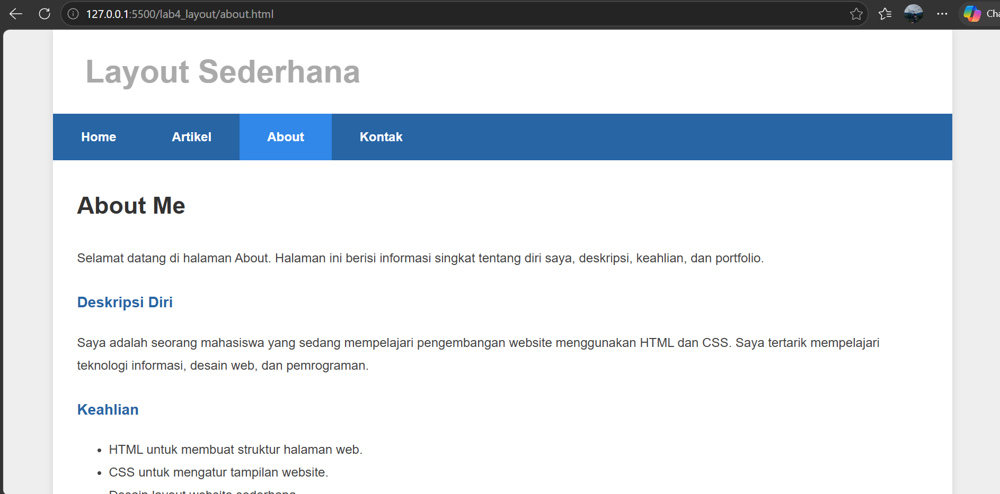

---

## 2.16 Tugas Praktikum: Membuat Halaman Contact

Pada tahap ini, dibuat halaman **Contact** yang berisi formulir untuk mengirimkan pertanyaan, saran, atau pesan.

### A. File `contact.html`

File ini berisi struktur halaman Contact dengan formulir nama lengkap, email, subjek, pesan, dan tombol kirim.

```html
<!DOCTYPE html>
<html lang="id">
<head>
    <meta charset="UTF-8">
    <meta name="viewport" content="width=device-width, initial-scale=1.0">
    <title>Kontak - Layout Sederhana</title>
    <link rel="stylesheet" href="contact.css">
</head>
<body>
    <div id="container">

        <header id="header">
            <h1>Layout Sederhana</h1>
        </header>

        <nav id="menu">
            <ul>
                <li><a href="home.html">Home</a></li>
                <li><a href="artikel.html">Artikel</a></li>
                <li><a href="about.html">About</a></li>
                <li><a href="contact.html" class="active">Kontak</a></li>
            </ul>
        </nav>

        <main class="contact-content">
            <h2>Hubungi Kami</h2>

            <p>
                Silakan isi formulir di bawah ini jika ingin
                mengirimkan pertanyaan, saran, atau pesan.
            </p>

            <form class="contact-form" action="#" method="post">

                <div class="form-group">
                    <label for="nama">Nama Lengkap</label>
                    <input type="text" id="nama" name="nama"
                           placeholder="Masukkan nama lengkap" required>
                </div>

                <div class="form-group">
                    <label for="email">Email</label>
                    <input type="email" id="email" name="email"
                           placeholder="Masukkan alamat email" required>
                </div>

                <div class="form-group">
                    <label for="subjek">Subjek</label>
                    <input type="text" id="subjek" name="subjek"
                           placeholder="Masukkan subjek pesan" required>
                </div>

                <div class="form-group">
                    <label for="pesan">Pesan</label>
                    <textarea id="pesan" name="pesan"
                              placeholder="Tuliskan pesan Anda"
                              required></textarea>
                </div>

                <button type="submit" class="btn-submit">
                    Kirim Pesan
                </button>

            </form>
        </main>

        <footer id="footer">
            <p>&copy; 2026 - Layout Sederhana</p>
        </footer>

    </div>
</body>
</html>
```

### B. File `contact.css`

File ini digunakan untuk mengatur tampilan formulir, label, kolom input, area pesan, tombol kirim, navigasi, dan footer.

```css
/* ===== HALAMAN CONTACT ===== */
.contact-content {
    padding: 30px;
    background-color: #ffffff;
    color: #444444;
    min-height: 400px;
    line-height: 1.7;
}

.contact-content h2 {
    font-size: 30px;
    color: #333333;
    margin-top: 0;
    margin-bottom: 15px;
}

.contact-content p {
    font-size: 16px;
    margin-bottom: 25px;
}

/* Formulir */
.contact-form {
    max-width: 650px;
    margin-top: 20px;
}

.form-group {
    margin-bottom: 20px;
}

.form-group label {
    display: block;
    margin-bottom: 8px;
    font-weight: bold;
    color: #333333;
}

.form-group input,
.form-group textarea {
    width: 100%;
    padding: 12px;
    border: 1px solid #cccccc;
    border-radius: 4px;
    box-sizing: border-box;
    font-family: Arial, sans-serif;
    font-size: 15px;
    background-color: #ffffff;
}

.form-group input:focus,
.form-group textarea:focus {
    outline: none;
    border-color: #2765a5;
    box-shadow: 0 0 4px rgba(39, 101, 165, 0.3);
}

.form-group textarea {
    height: 150px;
    resize: vertical;
}

/* Tombol */
.btn-submit {
    padding: 12px 25px;
    background-color: #2765a5;
    color: #ffffff;
    border: none;
    border-radius: 4px;
    font-size: 15px;
    cursor: pointer;
}

.btn-submit:hover {
    background-color: #174878;
}

/* Tampilan HP */
@media (max-width: 600px) {
    .contact-content {
        padding: 20px;
    }

    .contact-form {
        width: 100%;
    }
}

/* ===== LAYOUT UTAMA ===== */
* {
    box-sizing: border-box;
}

body {
    margin: 0;
    background: #eeeeee;
    font-family: Arial, Helvetica, sans-serif;
    color: #444;
}

#container {
    width: 90%;
    max-width: 1260px;
    margin: 0 auto;
    background: #fff;
    box-shadow: 0 0 10px rgba(0, 0, 0, 0.1);
}

#header {
    padding: 45px 40px;
    background: #fff;
}

#header h1 {
    margin: 0;
    color: #aaa;
    font-size: 40px;
}

/* Navigasi biru */
#menu {
    background: #2765a5;
}

#menu ul {
    display: flex;
    list-style: none;
    margin: 0;
    padding: 0;
}

#menu ul li a {
    display: block;
    padding: 20px 35px;
    color: white;
    text-decoration: none;
    font-weight: bold;
}

#menu ul li a:hover,
#menu ul li a.active {
    background: #3188e8;
}

/* Footer */
#footer {
    padding: 15px;
    background: #333;
    color: white;
    text-align: center;
}

/* Tampilan layar kecil */
@media (max-width: 600px) {
    #container {
        width: 100%;
    }

    #header {
        padding: 25px 20px;
    }

    #header h1 {
        font-size: 30px;
    }

    #menu ul {
        flex-wrap: wrap;
    }

    #menu ul li a {
        padding: 15px;
    }
}
```

### C. Hasil Halaman Contact

Halaman Contact menampilkan formulir yang dapat diisi pengguna. Kolom nama lengkap, email, subjek, dan pesan menggunakan atribut `required` agar wajib diisi sebelum formulir dikirim.

**Screenshot hasil halaman Contact:**

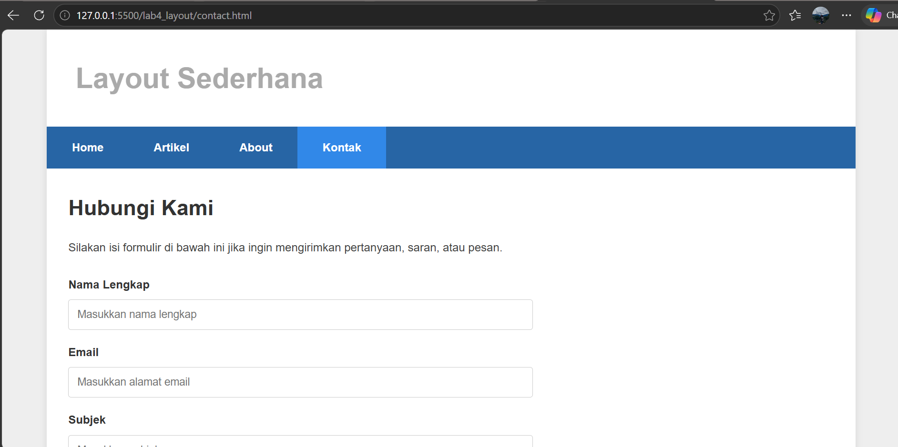

---

## 2.17 Kesimpulan Tugas

Berdasarkan tugas praktikum, halaman About dan Contact dibuat menggunakan HTML dan CSS. Halaman About menampilkan deskripsi diri, keahlian, dan portfolio, sedangkan halaman Contact menyediakan formulir untuk memasukkan informasi dan pesan. CSS digunakan untuk mengatur warna, jarak, navigasi, formulir, serta tampilan responsif.